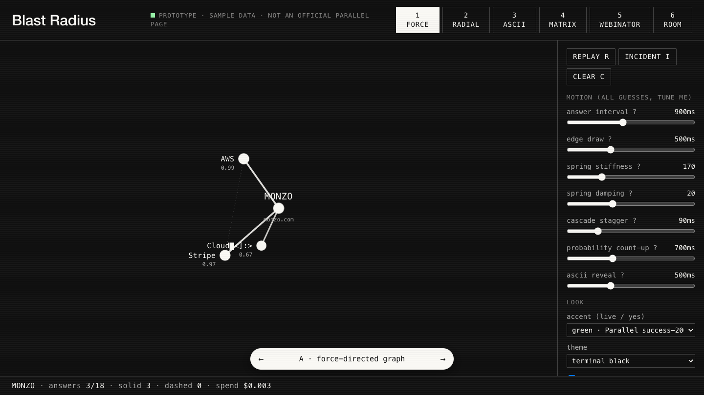

# 02 · Prototypes

One page for choosing how the graphs should look before building the real apps. It holds six variants (force, radial, ASCII, matrix, Webinator, room) on sample data, with every timing and spacing guess on a slider.

Open `index.html` in a browser. There is no server.
