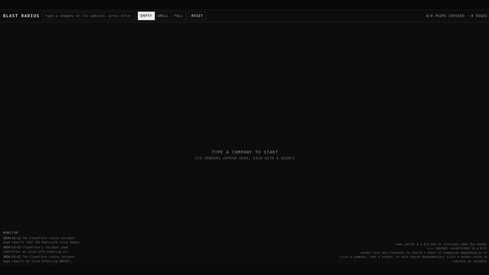

# 03 · Blast Radius



Type a company and its vendors appear, each one backed by a source from the live web. Add more companies to see which vendors they share. Then pick a vendor and simulate an outage to see which companies it would reach.

Full video: [../media/blast-radius-demo.mp4](../media/blast-radius-demo.mp4)

## Run

```sh
python3 03-blast-radius/server.py
```

Then open http://127.0.0.1:4101.

## How it reads the map

- Each company and vendor pair is one question to Parallel.
- A solid line means a probability above 0.6 and at least two sources that name the vendor. A dashed line is unconfirmed.
- Bigger vendors sit closer to the centre: more of the companies on screen depend on them.

A vendor relationship does not prove an outage would take a company offline. This is a map of cited dependencies, not a prediction.
