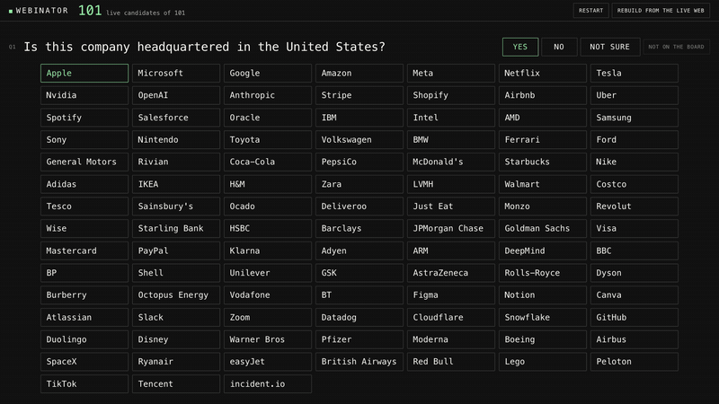

# 04 · Webinator



Think of a company from the board. Webinator asks yes or no questions, crosses out the companies that no longer fit, and guesses the one you picked. At the end it shows the sources behind each answer it relied on.

## Run

```sh
python3 04-webinator/server.py
```

Then open http://127.0.0.1:4102.

The answers for every company and question pair come from Parallel and are stored in `bank.json`. "Rebuild from the live web" asks them all again. `node 04-webinator/selfcheck.js` checks the guessing logic.
