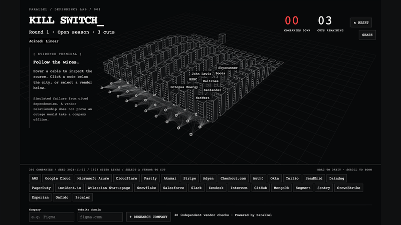

# 05 · Kill Switch

Run `python3 server.py`, then open http://127.0.0.1:4104.
Run `node check.mjs` for the scoring self-check. Regenerate seed with `python3 extract.py`.

Three cuts disable every company linked to the selected vendors. Cables require confidence strictly above 0.6 and at least one HTTP(S) citation. This is a dependency game, not an outage prediction.

The seed contains 12 companies, 30 vendors and 133 qualifying edges. AWS reaches 10, Experian 8, Onfido 7. There are 335 optimal triples reaching all 12; AWS + Google Cloud + Microsoft Azure is one. Identity vendors are not uniquely optimal.

Live research uses the shared Parallel client, with its cache redirected into this folder, ten executor workers and the client's eight-request semaphore and retry/backoff. Each company/vendor pair gets a separate call. Citation verification accepts the company domain or an exact company-name mention in title/excerpt; this is a heuristic, not entity resolution. No company evidence means a grey unverified tower. Adding a company starts a new round.

Normal mode preserves red pulses, readable labels and cable picking. `?ascii` enables the experimental Three.js AsciiEffect, which loses the red pulse colour. Three.js 0.170.0 loads from jsDelivr; seed research needs no API network, but the renderer requires CDN access on first load.

Verified: scoring assertions; loaded page; three cuts produce 12/12; reset restores 00/03; live Figma research returns 15 edges, verified=true, zero failures. Screenshot tool timed out; visual review and measured 60 fps are outstanding. All application writes and API cache files stay in this directory.

## Two-round demo update
Round 1 remains Open season with three cuts. Round 2 locks the named cloud hosts in `HARDENED_VENDORS` (game.mjs); locks are enforced in scoring and shown in both the city and buttons. Exhaustive seed enumeration: 91 restricted triples reach 12/12; exactly one restricted pair reaches 12/12 (SendGrid + Experian); the unique best single cut is Experian (8/12). Round 2 therefore uses two cuts. Budget and reveal are computed from current data, with at most three tied optima considered rare.

Three.js 0.170.0, OrbitControls, AsciiEffect and license are vendored locally. Restart server.py after this update to activate the asset allowlist. `node check.mjs` checks locked vendors and the restricted optimum. `python3 verify.py` uses the already-installed Playwright and Chrome, blocks all non-local HTTP requests, exercises both rounds, checks the disabled cloud button and saves four screenshots under screenshots/. Measured cascade: 60.0 fps (58.4 fps in the preceding run) at 1440×900 in headless Chrome. Screenshots visually inspected; physical projector readability and live research were not re-tested. Tower rise uses cubic ease-out; cable pulses travel for one second before collapse; hover emphasis is immediate; round 2 explicitly rebuilds the city and fades in its new heading.

## Expanded seed — 11 November 2026
The active seed now has 80 companies, 30 vendors and 647 qualifying edges. All 80 had at least one citation hosted on their own website domain; none were excluded. Generated at 19:29:44 UTC, displayed in the HUD. The previous seed is preserved as `seed-original.json`.

Run `python3 -u seed_expanded.py` to resume/build `seed-expanded.json`; it never promotes its output. `seed-progress.json` checkpoints every pair and HTTP attempt, with an exclusive process lock, eight workers, shared-client exponential retry/backoff and jitter, and a lifetime 2,970-request ceiling. This run completed 2,400 pairs with 2,349 actual HTTP attempts, including nine failed attempts; 60 pairs used cached results. No pairs remain failed. Reusing a checkpoint does not spend again for completed pairs. Do not delete the checkpoint to resume.

Exhaustive scoring chooses three cuts in each round. Open: 79/80, unique optimum AWS + Google Cloud + Microsoft Azure. Clouds locked: 67/80, two optimal sets; one is Cloudflare + Stripe + Experian. Top vendor reaches: AWS 69, Google Cloud 55, Cloudflare 42, Microsoft Azure 37, Stripe 36. Counts appear on buttons only when the round is over. Reveals and cut budgets derive from the loaded data.

Balance limitation: the obvious cloud triple really is the unique open optimum. No budget of one through three cuts creates the requested advantage over that obvious cloud strategy. In round two, taking the three highest-reach eligible vendors gets 65 versus the optimum 67, a modest two-company advantage. Evidence was not changed to force a surprising answer.

Rendering batches cables by vendor (30 draw calls) and instances window panes. Only eight nearby tower labels, the hovered tower and each tower briefly during its staggered collapse are shown. The canvas fills the viewport; the result panel replaces the evidence area on the left.

Validation: `node check.mjs` passes; `python3 verify.py --staged` tested the new seed before promotion, exercising both rounds and saving initial/cascade/locked/end screenshots under `screenshots/`. All four were visually inspected; cascade label crowding was fixed and screenshots regenerated. Staged 1440×900 headless Chrome measured 60.0 fps. UI Figma research returned 15 cited edges, zero failures, and a highlighted tower; endpoint Monzo returned 13 edges and zero failures. These verification lookups used cached Decisions responses. Fresh upstream calls were exercised by the seed run, but a cache-miss live form lookup and physical projector readability remain unverified. Actual account billing was not checked. No API key was printed or copied.

## Cut legibility update
Downed towers stay as lit red stubs; survivors keep white outlines and windows, and are all named once 16 or fewer remain. A cut is staged: pulses leave the vendor nearest-tower-first (visible through the towers), the tower fails on arrival, and its name, the per-cut tally ("Cloudflare cut: 42 down") and the score tick together in the right-hand readout. Earlier cuts fold to their summary line. The verdict panel and vendor counts wait for the last tower. Hovering or focusing a vendor (button or node) fills the towers it feeds, without a count. Timing constants are at the top of `scene.js`. `python3 verify-ux.py` exercises this and writes `screenshots/ux-*.png`; measured 60.0 fps (worst frame 16.8 ms) during the 69-tower cascade at 1440×900 headless Chrome, same as before. Not verified: a physical projector, a company joining mid-cascade, reduced-motion mode in a browser.

## Audience integration verification
`python3 verify-integration.py` exercises the live presenter with Playwright and loopback HTTP phone requests. It restarts port 4104, clears audience records, and restores production mode and an empty audience in `finally`. Do not run it during a live demo or alongside other browser verification scripts. `KILL_SWITCH_TEST=1` disables research (synthetic unverified companies), lowers the total cap to two, permits loopback-only `X-Test-Client` identities, and binds the server to loopback. This is test-only; normal mode retains 60 companies and three submissions per minute per IP.

Audience changes wait five seconds after the latest cut before applying; tower slots persist, including vacant removed slots. Existing death/rise times survive the rebuild. Best scores still recompute at round boundaries only. Falling names are omitted from the scene and remain in the casualty panel. Camera framing includes all vendor rows; join notices sit on the left, clear of SHARE and casualties. Markup names now receive a validation error rather than being silently stripped.

Integration results are in integration-results.log. No research API calls were made by this verification; cached/live research through the audience endpoint remains unverified. LAN access remains untested: the owner must change their Python firewall setting; no firewall setting or tunnel was changed.

## 200-company seed
`seed.json` now holds 200 companies (99 verified additions plus Farfetch, kept as unverified: no citation on its own domain). Citations are trimmed for size: at most three per link, one excerpt each, cut to 300 characters; the untrimmed build is `seed-expanded-full.json`. Previous seeds: `seed-80-backup.json`, `seed-100-backup.json`. The request cap in `seed_expanded.py` is 6,100 (5,960 used). `verify-integration.py` derives its expected counts from the loaded seed.
