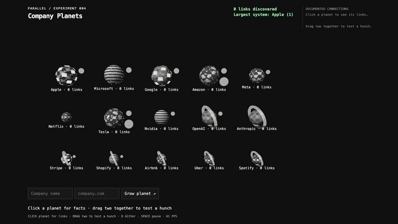

# 06 · Company Planets

Run `python3 server.py` here; open http://127.0.0.1:4105. The server stays bound to localhost. A tunnel may already be live: do not start, stop, or touch cloudflared. Manage only the listener on port 4105, never kill processes by name. No frontend build or runtime CDN.

## Connected from the start

The page loads all 105 seed-pair results from `seed-links.json`. Of these, 80 pass the display rule: probability **strictly greater than 0.6** plus a valid HTTP(S) citation. The offline preparation reused existing exact-query cache entries and made 39 upstream requests; no seed pair is researched when the page opens. Misses are “no documented link found,” never rivalry claims.

`seed-layout.mjs` chooses the three most-linked seed companies as hubs, then assigns one fixed, cited home per satellite. Capacity-balanced assignment gives priority to companies with fewer eligible hubs, then degree; this keeps three readable systems rather than one huge star. Additional documented ties remain faint until selected. The initial systems are:

- **Meta (14 links):** Microsoft, OpenAI, Stripe, Airbnb.
- **Amazon (13 links):** Apple, Netflix, Nvidia, Spotify.
- **Shopify (13 links):** Google, Tesla, Anthropic, Uber.

Each home is kinematic and parent-relative. Four satellites can share a shell with fixed phase spacing; additional shells and nested systems reserve their whole extent. Radius grows by 11% per link, capped at 65% over the company's base radius; mass scales with radius cubed. Hard separation runs after physics, growth and pointer motion.

Click a planet or label to highlight its connections and list linked companies, source links and readable excerpts in the side panel. Click a line or a linked company's name to focus that pair. Space pauses motion; D toggles dithering. The camera fits the systems automatically.

Dragging remains optional: “Drag two together to test a hunch.” Unchecked pairs use the visible checking lock, capture/bounce and evidence behavior. Checked pairs reuse their result. Moving a hub carries its descendants; dragging a satellite never removes a documented link and it returns to its orbit.

## Growing a planet

The form validates inputs and focuses an existing domain instead of adding a duplicate. New bodies spawn outside all occupied bodies and system envelopes. A white wireframe develops through 300 ms trait beats, with large fact/confidence callouts, elapsed time and answer progress. Completion shows defining traits, source count and a fact-sheet button. No domain evidence produces a labelled grey rock; failed or incomplete research offers Retry.

After the 20 facts, the server checks the new company against every existing planet in the submitted peer snapshot. Facts and pairs use one global pool of eight upstream slots. The shared Parallel client retries 429 and 5xx (including 504) with exponential backoff and jitter. Pair results stream back as `type: pair` events. The client draws every cited link and flies the new planet into exactly one home: the strongest cited result, then link count and name to break a tie. Existing homes do not change. A complete set of misses leaves it free with “no documented link found”; unavailable checks are reported distinctly.

The real Monzo browser run found six cited links and chose Stripe as its strongest home. Initial verification used 16 upstream attempts for the add (facts/pairs/retries combined), in addition to the offline seed's 39. `research-usage.json` records cumulative task usage; reruns use cached results.

## Spend guard for the public tunnel

Settings are named constants at the top of `server.py`:

- `MAX_COMPANIES = 60`: global **company additions** per process, across everyone. Each admitted add includes its 20 facts and one check per existing peer. Failed additions still consume their reservation.
- `MAX_ADDS_IN_FLIGHT = 2`: held through the facts **and** all automatic pair checks. A third add gets a busy response immediately rather than queueing.
- `MAX_MANUAL_PAIRS = 30`: separate cap for previously unchecked manual hunches; `MAX_MANUAL_IN_FLIGHT = 2`.
- `MAX_REQUEST_BYTES = 4096`: POST body limit; malformed names, domains and peer lists are rejected before budget admission.

An add's peer list is a fixed, deduplicated snapshot, restricted to the server's seed/admitted-company registry (at most 15 + 60 companies). There is no public “automatic pair” endpoint or reusable credit to bypass the manual cap. Completed company requests replay by normalized domain; pair results share an unordered-domain cache across automatic and manual work. Concurrent automatic/manual requests for one pair share one upstream lookup. Stored seed pairs and completed results are served even at either cap. Partial results and failures are retained, so repeated retries do not spend again. Work finishes and caches its results even if the requester disconnects.

To raise limits, edit the named constants and restart **only** the port-4105 server. Restarting resets the counters and in-memory add cache; the underlying disk cache and offline seed remain. Use one server process: these deliberately small guards do not coordinate across multiple processes. No credentials are sent to the browser. `/api/status` exposes only counters, never credentials or research inputs.

## Repeatable checks

- `node self-check.mjs`: fact/evidence mappings, relationship excerpts, strict confidence threshold.
- `python3 guard-check.py`: zero-spend HTTP tests for input/body/peer validation, the two-add limit across both stages, eight upstream slots, dedupe and single-flight, separate caps, cached reads at cap, and actual retry-loop behavior for stubbed 429/504 responses.
- `node guard-browser-check.cjs`: test-only busy/cap responses reach the caption and release collision locks.
- `node browser-check.cjs`: real installed Chrome/Playwright. Runs five connected-view cases from `connected-browser-check.cjs`, then all 16 earlier orbit/formation cases. The legacy section intercepts only the seed-edge response and automatic pair events, to exercise unchecked manual collision states that the connected seed no longer starts in. Its Monzo facts still use the real endpoint; manual interaction fixtures remain explicitly test-only. The connected section uses real Monzo research and all real automatic pair results, plus a test-only no-link add.

Browser assertions include 300 connected-seed frames with no sphere overlap, viewport containment, unchanged home assignments and ~60 FPS; cited selection and line focus; strongest-home automatic addition; and free-body no-link addition. The legacy cases retain checking-lock, capture, bounce, growth, four-link stress, dragging, nested capture, merging systems, 30-body performance, paced formation, invalid/duplicate/unverified/failure states and a continuous overlap audit.

Results and logs: `screenshots/browser-results.json`, `screenshots/browser-check.log`, `screenshots/connected-results.json`. Reviewed screenshots include `connected-opening.png`, `connected-clicked.png`, `connected-pair-focus.png`, `connected-added.png`, `connected-no-link.png`, plus the previous `orbit-*.png`, `formation-*.png`, capture and bounce frame sequences. The connected seed measured 60.00 average FPS and a 16.8 ms worst sampled frame on local headless Chrome at 1440×900.

`python3 research-seed-pairs.py` is the explicit, resumable offline preparation command. It is never invoked by the web server. Completed pairs are not researched again. `python3 cache-fixtures.py` exports existing cache entries without making requests.

## Data and limits

The 15 seeds were previously enriched with 300 Decisions calls. Responses/citations are saved in `seed.json`. Python uses `../shared/parallel.py`, with its cache redirected to this folder. No company traits are applied without at least one citation hosted on its supplied domain. Excerpts strip markup and metadata and omit speculative/negative sentences; if no readable sentence mentioning both companies remains, the source title/link is shown. Model probabilities and cited sources are not an independent audit of the underlying business relationship.

Formation and pair focus intentionally allow unrelated systems outside the close-up; the system view fits every body again afterward. Very large/deep systems, other viewport sizes and real projector hardware remain unverified. Load tests use generated duplicate seed bodies, not additional research. Vendored three.js r159 retains its MIT licence in NOTICE. Some minor traits still use geometric bands.
