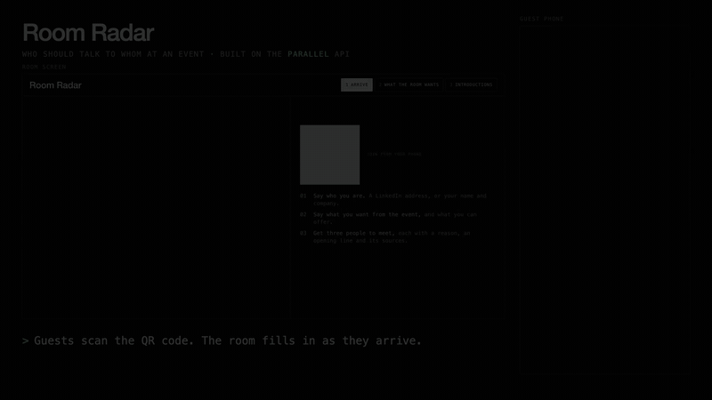

# 07 · Room Radar



A host screen for an event. Guests scan the QR code, answer three questions (who they are, what they want from the event, what they can offer), and get three people worth meeting. Each suggestion comes with a reason, an opening line and the sources it was based on.

Full video: [../media/room-radar-demo.mp4](../media/room-radar-demo.mp4)

## Run

```sh
python3 07-room-radar/server.py          # port 4108, prints the host link
python3 07-room-radar/server.py --check  # self-check
./07-room-radar/run-public.sh            # same, behind a Cloudflare quick tunnel so phones can join
```

## How it works

- A guest can paste a LinkedIn address or type their name, role and company. What they type wins.
- Parallel compares each pair of guests against the live web and scores how useful an introduction would be.
- The room screen has three views: who has arrived, what the room came for, and who should talk.
- Tick someone off as met and the shortlist refills.

## What guests agree to

- Joining is opt-in, and the consent box must be ticked.
- Name, role, company and chosen aims appear on the room screen. What a guest writes in their own words stays private.
- A LinkedIn photo is shown only if the guest ticks that box and the photo is public.
- Nothing is saved to disk. A guest can delete themselves at any time, and restarting the server wipes the room.

The sample guests are fictional.
