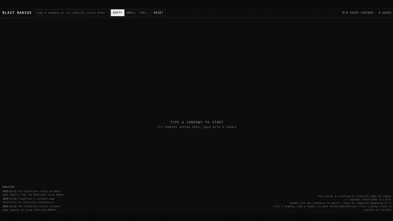
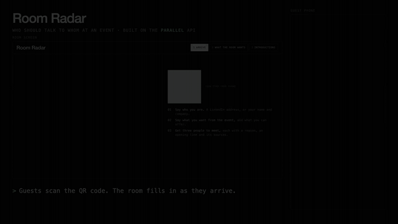
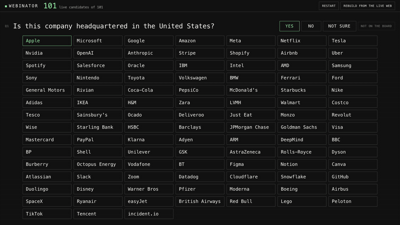
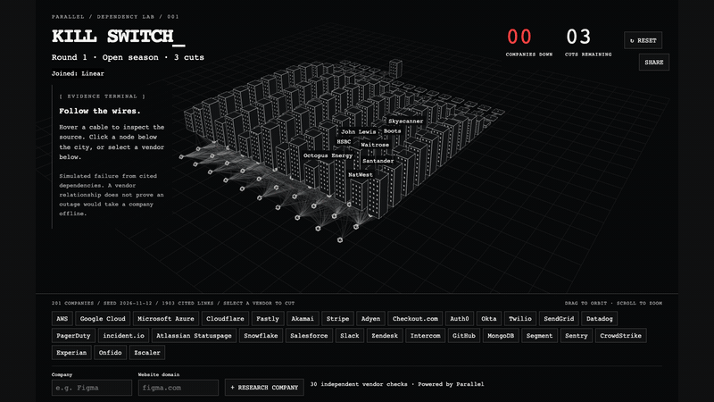
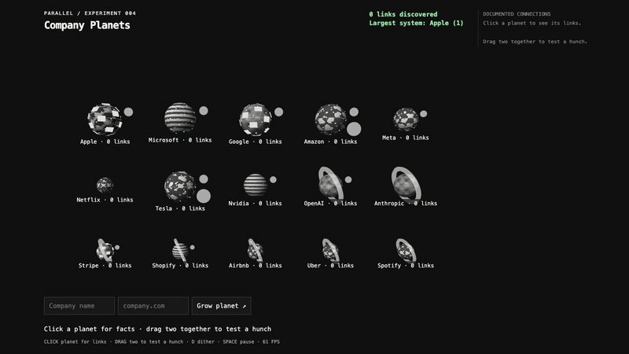

# Parallel hackathon experiments

Seven small things built in a two hour build night on the [Parallel](https://parallel.ai) API, in the order they were made. Each one asks the live web a lot of small questions and shows the answers with their sources.

Video of the two main demos (Blast Radius, then Room Radar): [media/parallel-hackathon-demos.mp4](media/parallel-hackathon-demos.mp4)

| | Project | What it does |
| --- | --- | --- |
| 01 | [Recon](01-recon) | Scripts that tested each idea against the API before anything was built. |
| 02 | [Prototypes](02-prototypes) | One page for picking the look of the graph, with every guess on a slider. |
| 03 | [Blast Radius](03-blast-radius) | Type a company, see the vendors it depends on, then take one vendor down. |
| 04 | [Webinator](04-webinator) | Think of a company. It asks yes or no questions and guesses which one. |
| 05 | [Kill Switch](05-kill-switch) | A city of companies. You get three cuts to take down as many as you can. |
| 06 | [Company Planets](06-company-planets) | Companies as planets that fall into orbit when a documented link is found. |
| 07 | [Room Radar](07-room-radar) | Guests join a room from their phone and get three people worth meeting. |

## What was done when

The event was Agentic Web · Build Night by Parallel and The No Agenda Club on 11 November 2026: two hours to build. All times are GMT and come from file dates and the session logs.

> [!NOTE]
> **Before the build:** ideas only. More than a week earlier I spent about 30 minutes in a Claude session thinking through concepts, which became one file, [agentic-web-ideas.md](agentic-web-ideas.md), saved at 18:52 on the night. No code, designs or data existed before 18:54.

> [!IMPORTANT]
> **During the build (18:54 to about 20:36, 11 Nov):** every app in this repository, the designs, the shared client and the seed data.

> [!TIP]
> **The morning after (10:30 to 11:30, 12 Nov):** a bigger Kill Switch seed (100 to 200 companies), fixes to Company Planets, the demo videos and GIFs, the READMEs, the folder numbering and this repository. Blast Radius was the one demoed on the night.

The Parallel API usage for all of it came to less than $10.

```mermaid
gantt
    title Build night, 11 November (GMT)
    dateFormat HH:mm
    axisFormat %H:%M
    section Plan
    Read ideas, pick three, install Parallel      :18:54, 8m
    section Validate
    01 Recon, one agent per idea, in parallel     :19:02, 5m
    section Design
    02 Look picker, six variants                  :19:04, 14m
    design.md agreed                              :milestone, 19:29, 0m
    section Build
    03 Blast Radius, first version                :19:09, 15m
    03 Blast Radius, redesign and polish          :19:24, 47m
    04 Webinator, build then polish               :19:10, 86m
    Room Radar v1, company only (archived)        :19:11, 19m
    Room Radar v2, curated intros (archived)      :19:33, 29m
    07 Room Radar, final, phone join and tunnel   :19:36, 53m
    05 Kill Switch, three.js game                 :19:13, 50m
    06 Company Planets, three.js                  :19:36, 53m
```

| Time | What happened | Who did it |
| --- | --- | --- |
| Over a week before | About 30 minutes thinking through ideas, concepts only | Me, in a Claude session |
| 18:52 | Ideas list saved | Me, before kickoff |
| 18:54 | Kickoff. Talked through the ideas and picked three | Me and Claude, with a questioning skill |
| 18:59 | Installed the Parallel CLI from `parallel.ai/agents.md` | Claude |
| 19:02 | Three agents tested one idea each against the real API, with a 10 minute limit | 3 Claude agents in parallel |
| 19:04 | A design agent built the look picker while the tests ran | 1 Claude agent with the design skills |
| 19:09 | Three apps started at once, one folder each | 3 Claude agents in parallel |
| 19:13 | Fourth idea, Kill Switch, handed to a different model in a side thread | GPT agent |
| 19:20 | I said Blast Radius looked bad. Picked variant B from the look picker and rebuilt it | Me, then Claude |
| 19:29 | `design.md` written from the variants I approved | Design agent |
| 19:33 | I said Room Radar made no sense. Rebuilt it around curated introductions | Me, then Claude |
| 19:36 | Fifth idea, Company Planets, started. Room Radar final version started in its own thread | GPT agent, Claude |
| 19:39 | Kill Switch user experience pass | Claude agent with the design skills |
| 19:55 | Polish passes on Blast Radius, Webinator and Room Radar, all at once | 3 Claude agents in parallel |
| 20:01 | Public tunnel so phones in the room could join Room Radar | Claude |
| 20:16 to 20:36 | Small fixes from trying the apps: reset button, empty state, click to follow links | Claude |

### How the work was split

- **One main thread, many workers.** I stayed in one conversation that planned and reviewed. It handed each job to a separate agent with a time limit and one folder to work in, so agents could not collide. That night it used 12 Claude agents and 11 tasks given to a GPT model.
- **Test before building.** Each idea was first tried against the real API ([01-recon](01-recon)). The timings and source counts decided which ideas were worth building.
- **Design ran beside the build.** The look picker ([02-prototypes](02-prototypes)) was built while the first versions of the apps were being written. Once I picked variants, the apps were restyled to match.
- **I was the reviewer.** I opened each app as it came up and said what was wrong. Blast Radius and Room Radar were both rebuilt after that.
- **Two models.** Claude built Blast Radius, Webinator and Room Radar. A GPT model built Kill Switch and Company Planets, with Claude doing the design review.

Skills used

| Skill | Used for |
| --- | --- |
| `brainstorming`, `grilling` | Questioning the ideas before picking any |
| `prototype` | The look picker: several variants behind one switch, with sliders |
| `ask-emil`, `design-foundations` | Choosing which design skill to use, then layout and hierarchy |
| `animations` | How the graphs move |
| `ui-polish`, `touch-and-accessibility` | Finish, tap targets and keyboard use |
| `ui-review` | A written review of each app before it was shown |
| `parallel-cli` skills | Search, extract and task calls to Parallel |

## 03 · Blast Radius

## 07 · Room Radar

## 04 · Webinator

## 05 · Kill Switch

## 06 · Company Planets

## Running one

Everything is Python 3 standard library on the server and plain HTML, CSS and JavaScript in the browser. There is no build step.

1. Get a Parallel API key and either set `PARALLEL_API_KEY` or sign in with `parallel-cli`.
2. Run the project's server, for example `python3 03-blast-radius/server.py`.
3. Open the address it prints.

[shared/parallel.py](shared/parallel.py) is the one client all the apps use. It reads the key at run time, caches answers on disk and limits how many requests run at once.

## Notes

- [ideas.md](ideas.md) and [agentic-web-ideas.md](agentic-web-ideas.md): the ideas this started from.
- [recipes.md](recipes.md): which Parallel call fits which job, with measured timings.
- [design.md](design.md): the shared look.

These are hackathon prototypes. The dependency and matching results are suggestions with sources attached, not verified facts.
